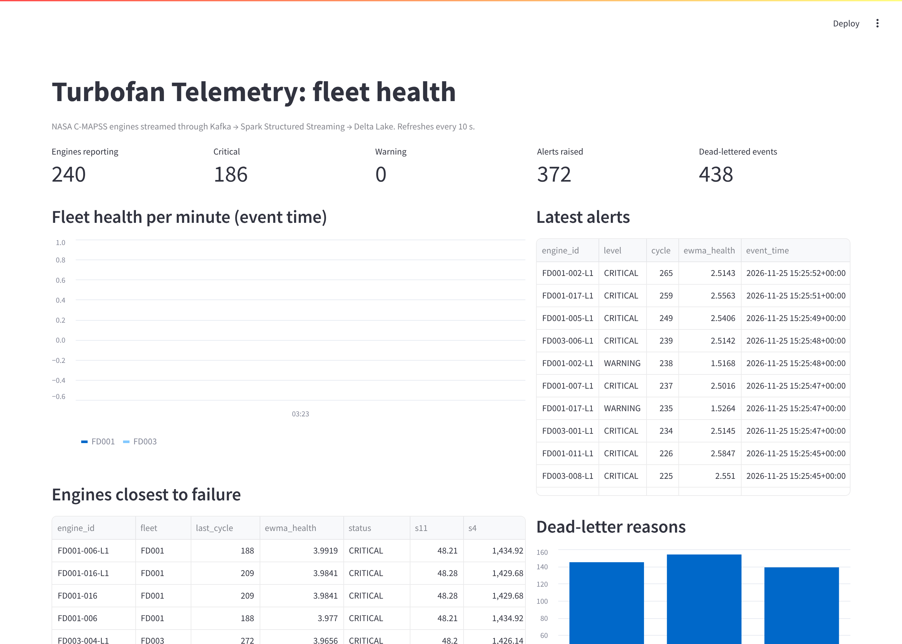

# Turbofan Telemetry Streaming Platform

Real-time pipeline for jet-engine sensor data. **NASA's public C-MAPSS turbofan dataset** (200 engines, each run
until failure) is replayed as a live fleet into **Kafka**, processed by **Spark Structured Streaming** into
**Delta Lake** bronze/silver/gold tables, and turned into **engine health scores and predictive degradation alerts**,
with exactly-once guarantees proven under duplicates, late data, malformed data and a hard crash.

```
NASA C-MAPSS ─► Producer ─► Kafka (6 partitions) ─► Bronze (raw) ─► Silver (validated, deduped) ─► Gold (engine state, alerts, fleet health)
  200 engines     chaos:       key = engine_id        Delta           + Dead-letter table            foreachBatch + MERGE    ─► Dashboard
                  dup/late/bad                                                                                             ─► verify (exactly-once)
```
Full diagram and guarantees: [docs/architecture.md](docs/architecture.md) · How it was built, every decision and every bug: [docs/build-log.md](docs/build-log.md)

## Results (measured)

<!-- RESULTS:START -->
From `scripts/demo.sh` (2 waves, chaos on, `kill -9` of the Spark app mid-stream, then restart):

| What | Result |
|---|---|
| Messages sent to Kafka | 57,452 (wave 1: 47,578 incl. 2,227 duplicates, 1,386 late by 30 s, 438 malformed / incomplete / out-of-range; wave 2: 9,874) |
| Valid unique events expected | 54,787 |
| In silver after the crash and restart | **54,787: 0 missing, 0 duplicates, 0 unexpected → PASS** |
| Dead-letter table | 438 = 145 `MALFORMED_JSON` + 154 `MISSING_FIELD` + 139 `OUT_OF_RANGE` (all of them, none leaked into silver) |
| Alerts | 345 raised, 345 distinct (each engine × level exactly once) |
| Producer throughput (single process, laptop) | ~28,000 msgs/s unthrottled |


<!-- RESULTS:END -->

**Alert quality on real NASA data (FD001, 100 engines run to failure):** WARNING fires a median **44 cycles before
failure** (90% of engines at least 27 cycles ahead), CRITICAL a median **18-19 cycles** before, **100% of engines caught**.
On FD003, 56% caught: the second fault mode (fan) isn't detected yet. Analysis in build-log F14; improving it is Milestone T1.

## What it demonstrates

| Skill | Where |
|---|---|
| Event-based ingestion, Kafka partitions, keys, idempotent producer | `telemetry/producer.py`, `telemetry/admin.py` |
| Structured Streaming, checkpoints, backpressure (`maxOffsetsPerTrigger`) | `telemetry/jobs/bronze.py` |
| Schema validation, dead-letter handling, watermark deduplication | `telemetry/jobs/silver.py` |
| Stateful processing with idempotent MERGE, event-time windows | `telemetry/jobs/gold.py` |
| Data quality + exactly-once **verification** (not just claims) | `telemetry/report.py`, `scripts/demo.sh` |
| IoT / predictive-maintenance domain logic, unit-tested | `telemetry/events.py`, `tests/` |
| Delta Lake (ACID, MERGE), delta-rs, Streamlit dashboard | `dashboard/app.py` |

## Quick start (no accounts or logins needed)

**You need:** [Docker Desktop](https://www.docker.com/products/docker-desktop/) (sign-in optional, skip it),
Python 3.10-3.12, Java 17 ([Temurin](https://adoptium.net/)). On Windows, use WSL2 (Ubuntu) for the commands below.

```bash
git clone <this repo> && cd turbofan-telemetry
python -m venv .venv && source .venv/bin/activate
pip install -r requirements.txt
pytest -q                                   # 10 unit tests, ~0.1 s
docker compose up -d                        # Kafka on localhost:9092, Kafka UI on http://localhost:8080
python -m telemetry.cli download            # NASA C-MAPSS, ~12 MB, public
./scripts/demo.sh                           # full run with chaos + crash + verification (~6 min)
streamlit run dashboard/app.py              # http://localhost:8501
```
The first Spark start downloads the Kafka and Delta connector jars from Maven Central (~1 minute, once).

**Option B, no Java/Python on your machine:** `docker compose --profile app run --rm app download`, then
`docker compose --profile app run --rm app stream` (and `produce`, `report`, `verify` the same way).

### Commands
| Command | Does |
|---|---|
| `python -m telemetry.cli create-topic --partitions 6` | create the Kafka topic |
| `python -m telemetry.cli stream [bronze silver gold]` | run streaming layers (Spark UI: http://localhost:4040) |
| `python -m telemetry.cli produce --rate 500 [--chaos] [--start-loop N]` | replay the fleet into Kafka |
| `python -m telemetry.cli report` | counts, duplicates, dead letters, latency p50/p95/p99, alerts, peak throughput |
| `python -m telemetry.cli verify` | exactly-once check: producer manifest vs silver |
| `python -m telemetry.cli reset` | delete local tables and checkpoints |

## Project layout
```
telemetry/          cmapss.py (data) · events.py (contract + domain logic) · producer.py · admin.py · cli.py
telemetry/jobs/     bronze.py · silver.py · gold.py · run.py
tests/              pure-Python unit tests (no Spark/Kafka)
dashboard/app.py    Streamlit fleet dashboard
scripts/demo.sh     end-to-end run with a crash in the middle
docs/               architecture.md · build-log.md · decisions.md · capacity-plan.md
MILESTONES.md       learning path, extension tasks, interview questions
```

## Data
NASA Prognostics Center of Excellence, *Turbofan Engine Degradation Simulation Data Set* (C-MAPSS),
A. Saxena and K. Goebel (2008). Public domain, downloaded from the NASA PHM data repository mirror.
