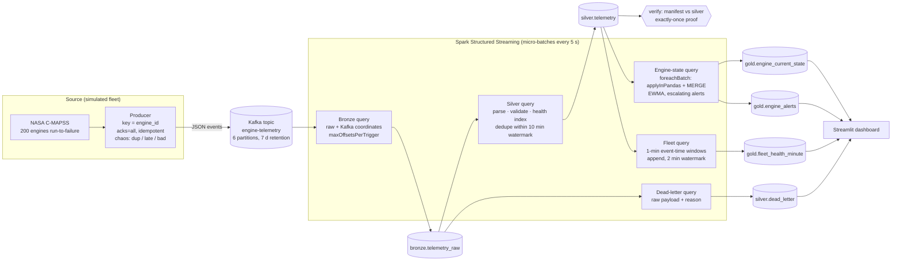

# Architecture

## Guarantees and how each is achieved

| Guarantee | Mechanism |
|---|---|
| No message lost between Kafka and bronze | Spark checkpoint stores offsets; a batch's offsets are committed only after the Delta write commits |
| No partial files | Delta Lake atomic commits (transaction log) |
| Duplicates removed | Deterministic `event_id` + `dropDuplicatesWithinWatermark` (10 min) |
| Bad data never blocks good data | Validation in silver; invalid rows to the dead-letter table with a reason |
| Per-engine ordering | Kafka key = engine_id (same partition); state applies events in cycle order |
| Alerts raised exactly once | MERGE on `alert_id = engine:LEVEL`, insert-only |
| Re-running a batch is harmless | State ignores cycles ≤ last applied; alert ids already exist |
| Bounded memory | Watermarks drop old dedupe/window state; RocksDB state store |
| Controlled catch-up after outage | `maxOffsetsPerTrigger` |

## Tables

| Table | Grain | Key columns |
|---|---|---|
| bronze.telemetry_raw | one Kafka message | partition, offset |
| silver.telemetry | one valid engine cycle | event_id |
| silver.dead_letter | one rejected message | partition, offset, dlq_reason |
| gold.engine_current_state | one engine | engine_id |
| gold.engine_alerts | one engine × level | alert_id |
| gold.fleet_health_minute | one fleet × minute | window_start, fleet |
